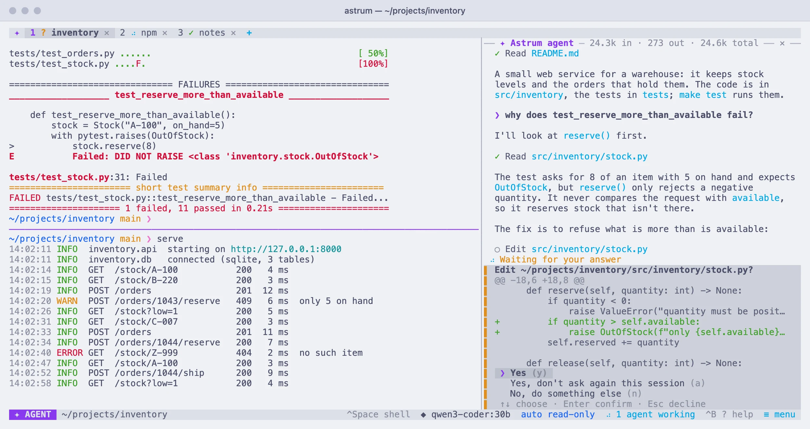
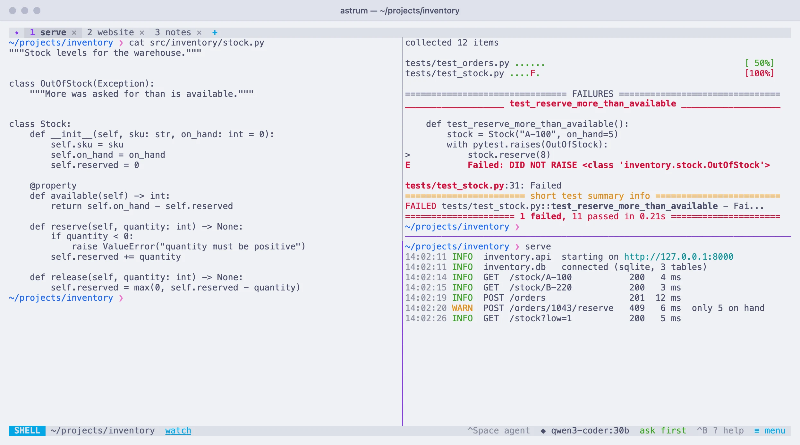
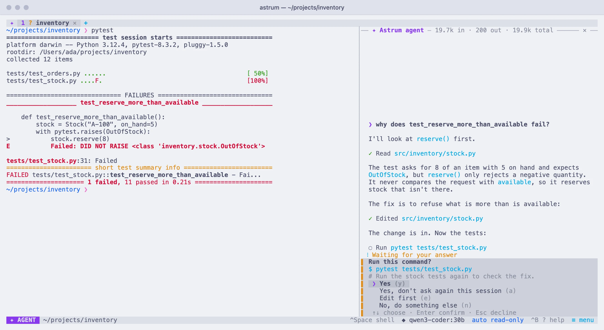

<h1 align="center">
<picture>
  <source media="(prefers-color-scheme: dark)" srcset="site/assets/logo/astrum-wordmark-on-dark.svg">
  
</picture>
</h1>

<p align="center"><a href="https://robert-mcdermott.github.io/astrum/">Website</a> · <a href="https://robert-mcdermott.github.io/astrum/docs/">Documentation</a> · <a href="https://github.com/robert-mcdermott/astrum/releases">Releases</a></p>

A persistent terminal with tabs, mouse support and a built-in AI agent. It runs
inside whatever terminal app you already use, locally or over SSH, as a single
self-contained binary.

- **Feels like your normal shell.** Run `astrum` and you are in your usual
  zsh/bash/fish with your own prompt and colors, plus a tab bar.
- **Sessions survive.** Close the window, come back later, run `astrum` again:
  every tab, running program and scrollback is still there. After a reboot
  or a crash the tabs, their splits, directories and scrollback come back too.
- **Easy for everyone.** Click tabs, click `+`, click `✕`, scroll with the
  wheel, drag to select and copy, right-click for a menu, and `≡ menu` in the
  status bar for everything else. Keyboard shortcuts exist for people who
  want them.
- **Room to work.** Split a tab into panes and drag the dividers, search the
  scrollback, open links, see the pictures programs print, and look at the
  same session from several windows, each with its own tab in front.
- **Other machines, without losing your place.** Open a tab on a server
  over your own `ssh`: its shells are kept there, so a dropped connection or
  a closed laptop loses nothing, and the agent works there with all its
  tools. Or take the agent along into an `ssh` you started yourself.
- **An agent that shares your shell.** Press `Ctrl+Space` and ask. It reads what
  is on screen, proposes commands and runs them in your real session, where you
  can watch and take over. You decide how much it may do on its own.
- **Any model.** Ollama and every OpenAI-compatible endpoint, Anthropic, and
  Amazon Bedrock. Switch with `/model`.
- **Themes.** Out of the box Astrum uses your terminal's own colors and
  changes nothing about how it looks. Twenty-one more are built in, from
  calm to neon, with live preview: `/theme`.

<picture>
  <source media="(prefers-color-scheme: dark)" srcset="site/images/hero-dark.webp">
  
</picture>

Astrum does not depend on any other program at run time (a tab on another
machine is reached with the `ssh` you already have). See
[ROADMAP.md](ROADMAP.md) for where it is going and what is not done yet.

## Install

Astrum is one file. Release builds are there for macOS on Apple silicon and
for Linux on x86-64 and ARM64 (from version 0.4.0 on). To install the latest
as `~/.local/bin/astrum`:

```bash
curl --proto '=https' --tlsv1.2 -fsSL https://raw.githubusercontent.com/robert-mcdermott/astrum/main/install.sh | sh
```

The installer works out which file this machine needs and downloads it and
`SHA256SUMS` from the release. It checks the file's SHA-256 checksum against
that list, runs it to see that it is Astrum and the version expected, and
only then moves it into place, so a download that went wrong never replaces
a copy that works. It does not use `sudo`, change your `PATH` or start
anything. If `~/.local/bin` is not on your `PATH` it says so, and prints the
full path to run. Running it again installs the newest release over the old.

The Linux builds are fully static: they need nothing from the system, and
run on old and new distributions alike.

To read the installer before running it:

```bash
curl --proto '=https' --tlsv1.2 -fsSLo install-astrum.sh https://raw.githubusercontent.com/robert-mcdermott/astrum/main/install.sh
```

```bash
less install-astrum.sh
```

```bash
sh install-astrum.sh
```

`sh install-astrum.sh --version v0.4.0` installs a particular release, and
`--install-dir DIR` puts it somewhere else (`ASTRUM_VERSION` and
`ASTRUM_INSTALL_DIR` do the same for the one-line form). To check a download
by hand instead, take the file for your machine and `SHA256SUMS` from the
[releases page](https://github.com/robert-mcdermott/astrum/releases) and
compare:

```bash
shasum -a 256 astrum-darwin-arm64
```

(`sha256sum` on Linux.) To remove Astrum, delete the file; its settings are
in `~/.config/astrum` and what it saved in `~/.local/share/astrum`.

**Completions and the manual.** `astrum completions bash` (or `zsh`, or
`fish`) prints a completion script; the first lines of each say where to put
it. `astrum man` prints the manual page, which the installer also places
where `man astrum` finds it.

### Building from source

Needs a Rust toolchain (1.88 or newer) and a C compiler.

```bash
cargo install --path . --locked
```

`--locked` builds with the exact dependency versions recorded in `Cargo.lock`,
the ones Astrum is tested with. Or build without installing; the binary is
`target/release/astrum`:

```bash
cargo build --release --locked
```

If `cargo` or `astrum` is "not found" afterwards, `~/.cargo/bin` is not on
your `PATH`; add `. "$HOME/.cargo/env"` to your shell's startup file.

## Use

```bash
astrum
```

| Do this | With the mouse | With the keyboard |
| --- | --- | --- |
| New tab | click `+` | `Ctrl+B` then `c` |
| New tab on another machine | `≡ menu` → New tab on another machine… | `Ctrl+B` then `R` |
| Switch tab | click it (or wheel over the tab bar) | `Ctrl+B` then `n` / `p` / `1`–`9` |
| Close tab | click its `✕`, or middle-click | `Ctrl+B` then `x`, or `exit` in the shell |
| Split the pane | right-click it, or `≡ menu` | `Ctrl+B` then `\|` (side by side) or `-` (one above the other) |
| Move between panes | click the pane | `Ctrl+B` then an arrow key |
| Resize panes | drag the divider between them | |
| Zoom one pane to fill the tab, and back | right-click it | `Ctrl+B` then `z` |
| Close a pane | right-click it | `Ctrl+B` then `x`, or `exit` in its shell |
| Rename tab | right-click it | `Ctrl+B` then `,` |
| Move a tab | drag it along the tab bar | `Ctrl+B` then `<` / `>` |
| Menu for a tab or pane | right-click it | |
| Menu of everything else | click `≡ menu` in the status bar | `Ctrl+B`, then click or type an entry |
| Scroll back | mouse wheel | `Shift+PageUp` / `Shift+PageDown` |
| Find in scrollback | `≡ menu` → Find, or right-click the pane; then the `↑` `↓` buttons | `Ctrl+B` then `/`; `Enter` for the next older match, `Esc` to close |
| Copy text | drag (copies on release); double-click a word | `Ctrl+B` then `[` (copy mode) |
| Open or copy a link | right-click it → Open link / Copy link, or `Ctrl+click` | |
| Talk to the agent | click the `SHELL` chip | `Ctrl+Space`, or `# question` at the prompt |
| Explain or fix a failed command | click `explain` or `fix` in the status bar | `Ctrl+B` then `e` / `f` |
| Have the agent watch a running command | click `watch` in the status bar | `Ctrl+B` then `o` |
| See every tab's agent | click `agents working` (or `asking`) in the status bar, or `≡ menu` → Every agent at a glance | `Ctrl+B` then `A`, or `/agents` |
| Take the agent into a shell you reached (`ssh`, `sudo -s`) | click `take the agent in` in the status bar | `Ctrl+B` then `i` |
| Leave, keep everything running | close the window, or `≡ menu` → Detach | `Ctrl+B` then `d` |
| Settings | `≡ menu` → Settings | `Ctrl+B` then `.`, or `/settings` |
| Help | click `? help` | `Ctrl+B` then `?` |

<picture>
  <source media="(prefers-color-scheme: dark)" srcset="site/images/panes-dark.webp">
  
</picture>

Everything on the status bar can be clicked: the `SHELL` / `AGENT` chip
switches between the two, the model name opens the model list, the autonomy
level steps through its settings, and `≡ menu` lists every action with the
key that does the same. After `Ctrl+B` the status bar shows what can follow
it for ten seconds; type the key or click the entry.

**Links.** A web address in a pane can be followed, and so can a link a
program marked as one (`ls --hyperlink`, `gh`, compilers that link to
documentation). Point at it and the status bar shows where it really goes,
which for a marked link may not be what its text says. Right-click it for
Open link and Copy link, or `Ctrl+click` it. (In terminals that keep
`Ctrl+click` for themselves, such as macOS Terminal, the right-click is the
way.) Astrum opens web and mail links and nothing else, with the system's
own `open` or `xdg-open` on the machine where you ran `astrum` (for a tab on
another machine, that is still this one; for `astrum` run inside `ssh`, the
far machine, where it may have nowhere to open). A link to a
file is not opened, because opening a file can mean running it; it can
still be copied.

**Pictures.** A picture a program prints is shown in the pane: `imgcat`,
`kitten icat`, `chafa`, `img2sixel`, a plotting library that draws to the
terminal. It scrolls with the text around it, is cleared with it, and is
there again when you look back through the scrollback. The three ways
programs send pictures are all understood (iTerm2's, kitty's and sixel),
and each attached terminal is sent the picture in a way that terminal has:

| Your terminal | What it is shown |
| --- | --- |
| iTerm2, WezTerm | everything, except raw pixels a program sent compressed in kitty's way |
| Ghostty, kitty | pictures sent in kitty's way, and PNG files sent in iTerm2's |
| A terminal that only draws sixel | sixel pictures |
| macOS Terminal, and others with no pictures | a line saying what the picture is |

Where a picture cannot be shown, a faint block the size it would have been
takes its place, with a line such as `PNG 640×480 · this terminal cannot
show it`. The same block stands in while a picture is partly off the edge
of its pane or under a menu: a terminal cannot be asked for part of a
picture, so it is drawn whole or not at all. A picture is drawn once it has
been still for a moment, not at every line while output is pouring past.

Things to know:

- A program finds out whether pictures work by asking, and is answered for
  the terminal you are using at that moment. One that decides from the
  name of the terminal sees `TERM_PROGRAM=astrum` and may need telling
  (`chafa -f kitty`, `viu` with its protocol option).
- Astrum does not decode pictures, which is why some pairs in the table
  are missing: a JPEG cannot be turned into what kitty's way needs, and
  nothing can be turned into sixel.
- Moving pictures sent as one frame after another (a video player drawing
  to the terminal) are not shown: no frame stays still long enough.
- Pictures are not saved with a session, and are not shown to the agent,
  which is told `[PNG 640×480]` in their place.
- `images = false` in the config turns them off; the line saying what each
  picture is stays. If Astrum is wrong about your terminal, the
  environment variable `ASTRUM_IMAGES` says outright which ways it has:
  `kitty`, `iterm`, `sixel`, several with commas, or `none`.

**Finding things in the scrollback.** The search looks through everything a
pane still remembers, newest first, and finds as you type. Small letters
find capitals too; a capital letter in what you type makes the search exact.
The bar shows which match you are on and how many there are, with `↑` and
`↓` to step through them and `✕` to close.

**Copy mode** is the keyboard's way to select text. `Ctrl+B [` puts a cursor
in the pane that moves through the screen and the scrollback: arrows or
`h` `j` `k` `l`, `w` / `b` by words, `0` / `$` to the ends of the line, `g` /
`G` to the oldest and newest line, `PageUp` / `PageDown`. `v` starts
selecting (`V` whole lines, `Ctrl+V` a block), `y` or `Enter` copies and
leaves, `/` searches, `n` / `N` step through the matches, `q` or `Esc`
leaves. Nothing typed in copy mode reaches the shell.

Programs that use the mouse themselves (vim, htop) receive it as usual; hold
`Shift` while dragging to select text inside them, or while right-clicking
to get Astrum's menu rather than theirs.

A tab can be split into panes, each with its own shell, and split again as
often as there is room. A new pane starts in the directory of the one it was
split from. The divider is lit along the pane the keyboard is in; the mouse
wheel scrolls whichever pane it is over. Past the last pane, `Ctrl+B` with
the left or right arrow moves on to the next tab. Zooming hides the other
panes without stopping them, and the status bar says when a tab is zoomed.

The agent works in one pane at a time: the one the keyboard was in when you
asked. It stays there until it has finished, so you can move to another pane
and carry on working while it does; after that it follows the keyboard again.

The same session can be open in several terminal windows at once, and each
has its own view of it: its own tab in front, its own menus, drawn edge to
edge at its own size. So one window can stay on a build while another edits
in a different tab. Two windows looking at the same tab share it: what is
typed in one shows in the other, and the tab's shells are sized for the
window that used it last. The other window shows it at that size, with a
note, until a key or a click there brings it over.

Colors: terminals that support 24-bit color get each theme's exact colors.
Others (such as the built-in macOS Terminal on older systems) get the nearest
match from the 256-color palette. If colors look reduced over SSH, where
terminals often cannot announce 24-bit support, set `truecolor = true` in the
config.

Sessions:

```bash
astrum -s work
```

```bash
astrum ls
```

```bash
astrum kill -s work
```

**A session that stops comes back.** While a session runs, Astrum keeps on
disk what it would take to rebuild it: its tabs and their names, how each
is split into panes, the directory each shell is in, what each pane shows
and remembers, and each tab's conversation with the agent. After `astrum
kill`, a reboot, a crash or an upgrade, starting the session again brings
all of that back, with a line in each pane marking where the restored part
ends. The programs that were running are not restarted; each pane gets a
fresh shell in its old directory.

A session ends for good when you close its last shell: nothing of it is
kept, and the next start is a clean one. To stop a session and discard its
tabs in one go:

```bash
astrum kill --forget
```

`astrum ls` also lists stopped sessions that would come back. What is saved
lives in `~/.local/share/astrum/sessions/`, readable only by you; it includes
whatever was on screen. Set `restore = "layout"` in the config to keep the
tabs, panes and directories but nothing of what was on screen, or `restore =
"off"` to keep nothing.

**Running a session as a login service** is optional. Without it, a
session's server is started by the first `astrum` that asks for it.

```bash
astrum service install
```

hands the session to the system's service manager instead: it is started
when you log in, before you open a terminal, and started again if it stops
(so `astrum kill` becomes a restart, and the tabs come back).

- On Linux this is a systemd user service
  (`~/.config/systemd/user/astrum-<session>.service`). With lingering on
  (`loginctl enable-linger`), the session keeps running while you are logged
  out: shells, running programs and all.
- On macOS it is a launchd agent
  (`~/Library/LaunchAgents/io.github.robert-mcdermott.astrum.<session>.plist`).
  Logging out of macOS ends every process of yours, this one included; the
  session comes back restored at the next login.

`astrum service status` says whether it is installed and running, `astrum
service uninstall` removes it, and `astrum service install --print` shows
what would be written without doing it. Add `-s name` for a session other
than the default. Run `uninstall`, or an `install` that changes an existing
service, from a terminal outside the session: both restart or stop it. On
macOS the service's own log is `~/.local/share/astrum/service-<session>.log`.
A server started this way has only a bare environment:
API keys set in your shell's startup files reach it with `astrum reload`, or
store them with `/key`.

### Tabs on other machines

A tab can be on another machine. `≡ menu` → New tab on another machine…
(or `Ctrl+B` then `R`, or `/ssh host` in the agent panel) asks for the
machine, as you would name it to `ssh`: `web-3`, `deploy@web-3`, a name from
`~/.ssh/config`, or with options first (`-p 2222 web-3`, `-J jump web-3`).
Astrum runs your own `ssh` to get there, so your keys, your jump hosts and
your config apply as they are, and whatever `ssh` asks (a password, a new
host's fingerprint, a second factor) is shown in the pane for you to answer.

What makes it more than `ssh` in a tab is where the shells live. They are
not kept by the connection: Astrum's own program runs on the other machine
and keeps them there, the way the session server keeps your shells here.

- **A dropped connection loses nothing.** The pane says the connection was
  lost; the shell and whatever runs in it carry on. Astrum reconnects by
  itself (after 1, 3, 8 and 20 seconds, then every minute; Enter or the
  **Try again** button does it at once), and what was written meanwhile is
  there when it is back.
- **So does restarting this machine.** The tab is saved with the session
  and finds its shells again when the session next starts, a crash
  included. `astrum kill` ends them, as it ends the shells here; the tab
  still comes back, in a new shell in the same directory, under what the
  old one had shown.
- **It is an ordinary tab.** Split it and the new pane is on the same
  machine, in the same directory, over the connection that is already
  there. Scrollback, search, copying, links and pictures work as anywhere.
  The tab says which machine it is on (`web-3: src`), and so does the
  status bar (`⇢ deploy@web-3 ~/src`).
- **The agent has everything there that it has here.** Its commands run in
  the shell there, where you watch them. Reading and searching files, and
  changing them with a diff for you to approve first, are carried out
  there by Astrum's program. An `AGENTS.md` in the project there is read
  along with your own from here. The model, your API keys and the
  conversation stay on your machine.

**If Astrum is not on the other machine,** it asks before doing anything.
On a yes it takes the release build for that machine's kind of system,
verifies its SHA-256 checksum on your machine, and sends it over the
connection that is already open, to `~/.local/bin/astrum`. That is one file
in your home folder there: no root, no package manager, and that machine
needs no way out to the internet. It is run once before it is put in
place; if it will not run, nothing there is changed. On a no, nothing is
touched. The build comes from the release on GitHub the first time and is
kept for the next (`~/.local/share/astrum/builds`). `download_base` in the
config file (or `ASTRUM_DOWNLOAD_BASE`) names a mirror or a folder to take
it from instead, exactly as for the install script.

**Two versions of Astrum.** The two sides do not have to be the same
version. Each says which number of their common language it speaks, a
number that changes far less often than the version does, and any two
versions with the same number work together. If the Astrum there is older
and speaks an earlier one, Astrum offers to put its own version in
`~/.local/bin` there, again only on a yes. (Shells the older one is keeping
stay running under it, but cannot be shown by this version.) If the one
there is newer, nothing is replaced: Astrum says to update this machine.

**Logging out of the other machine.** The program there is started as one
of its own, which the connection closing does not take with it, and on
most systems that is enough to outlast a logout. A Linux system set to end
a user's programs at logout (`KillUserProcesses=yes`) needs lingering
turned on (`loginctl enable-linger`), the same switch `astrum service`
relies on: with it on, the program runs under your own systemd and stays.
Astrum tells you when a machine is set that way and lingering is off. The
program stops by itself twenty seconds after its last shell has ended. A
restart of that machine ends its shells, as it would anywhere; the tab
comes back in a new one.

**Where this cannot be used,** running `ssh` in an ordinary tab and
[taking the agent in](#on-another-machine) still can:

- a machine where you may not run a program of your own, or keep one
  running in the background (some shared hosts, restricted shells, and
  containers that are torn down when you disconnect);
- a system there is no build for: anything but Linux on x86-64 or ARM64
  and macOS on Apple silicon;
- an account whose `ssh` setup forces a command of its own (`RemoteCommand`
  in your config, `ForceCommand` on the server).

Things to know:

- `ssh` is run with the environment the session server was started with,
  so it uses the key agent (`SSH_AUTH_SOCK`) from then. A server started as
  a login service has a bare environment.
- Shells there belong to no one connection, so they have no agent
  forwarding and no X forwarding.
- After a short absence the pane simply continues: the last 4 MB each
  shell wrote is kept for that. After a longer one, or when this machine
  was restarted, the screen and its history are shown as they now stand;
  pictures are not carried over then, and links lose their targets.
- A tab closed while its connection is down leaves its shell running
  there until this session next reaches that machine, when it is ended.
- A machine you do not trust can lie to you and read what you type, as
  with any `ssh`. The agent's file work there is done by whatever answers
  as Astrum on that machine.

## The agent

`Ctrl+Space` moves the keyboard between the shell and the agent panel. The
status bar always shows which one you are typing into.

The panel opens below the shell, or beside it when the terminal is at least
140 columns wide, so that a wide window keeps the shell's full height. Drag
the line between them to resize either way. `agent_panel = "bottom"` or
`"side"` in the config file keeps it in one place whatever the width.

<picture>
  <source media="(prefers-color-scheme: dark)" srcset="site/images/approval-dark.webp">
  
</picture>

- Type a request and press Enter. `Shift+Enter` (or `Ctrl+J`) adds a line.
- The agent's commands run in the terminal pane above, in your own shell, so
  `cd`, environment variables and virtualenvs carry over, and you see the real
  output. If something asks for a password, press `Ctrl+Space` and type it yourself.
- Reading is never asked about: the agent can read files, find them by name
  and search their text on its own. Its searches skip version-control,
  dependency and build directories (`.git`, `node_modules`, `target` and the
  like).
- A command that takes a long time does not hold the conversation up: after
  a wait the agent is told it is still running, which program it is, when it
  last printed anything and whether it has been using the processor, so it
  can tell a command that is working from one that is waiting for something.
- If a command the agent runs lands in a pager (`less`, `man` and the like
  waiting for a key), Astrum closes the pager after its first screen and
  hands that screen to the agent, with a note to run it again unpaged.
- `!command` runs a shell command directly without involving the model.
- You can keep typing while the agent works. What you send is held just above
  the prompt and handed to the agent at its next step, with the result of
  whatever it was doing, so you can correct or add to a task without stopping
  it. `Backspace` on an empty prompt takes the last waiting message back.
- `Esc` stops the agent (and interrupts the command it was running). Messages
  still waiting return to the prompt.

### Secrets

What the agent gathers for the model (the output of commands, the files it
reads, what is on the terminal) is checked for secrets first, and each one
is replaced with a note such as `[redacted: GitHub token]`. Your terminal
still shows the real output; only the copy sent to the model changes, and
the panel says how many were hidden. It looks for:

- keys and tokens with a recognizable shape (cloud and source-hosting
  access keys, API keys, private key blocks, signed web tokens);
- passwords in URLs and in `Authorization` headers;
- lines that set something named like a secret (`DB_PASSWORD=...`,
  `--api-key=...`), as in an `env` listing or a `.env` file;
- the API keys Astrum itself is using for your providers, anywhere.

It is deliberately cautious about code, so that `token = get_token()` stays
readable, which means a secret that looks like an ordinary word in an
ordinary assignment can get through. Treat it as a safety net, not a
guarantee, and note that what you type to the agent yourself is sent as
written. `redact_secrets = false` under `[agent]` turns it off.

### Asking without leaving the shell

You do not have to switch to the agent panel to ask something. At the shell
prompt, start a line with `#` and a space:

```
# why is this directory so large
```

Press Enter and the line goes to the agent instead of the shell: it is erased
from the prompt, the panel opens to show the agent's work, and the keyboard
stays in the shell. If the agent is
already busy, the question waits for its next step, like anything typed in
the panel.

This needs the shell integration (zsh, bash and fish have it), and it only
applies to a line you type at a prompt, not to input for a running program.
Lines such as `#!/bin/sh` or `##` are left alone. Under `[agent]` in the
config file, `ask_prefix` chooses another prefix, and `ask_prefix = ""`
turns this off.

With `natural_language = true` there, a line that reads as plain language
goes to the agent without any prefix: several words, none of the shell's own
punctuation, starting with a word such as "how", "why" or "please", and
either ending in a question mark or not starting with the name of a program
on your machine. It is off by default because it is a guess. When it guesses
wrong, start the line with a space to make the shell run it as typed.

Astrum works out what you typed from the keys you pressed, including
corrections made with Backspace and the arrow keys. For a line the shell had
a hand in (recalled from history, or completed with Tab) it reads the line
from the screen instead, which works when the prompt has not changed since
you began typing and nothing follows the cursor. If it cannot be sure, the
line goes to the shell as usual.

**When a command fails**, the status bar shows its exit code with two
offers, `explain` and `fix`. Click one, or press `Ctrl+B` then `e` or `f`.
The agent is given the command, its exit code and its output, and either
tells you what went wrong or sets about fixing it (asking first, as your
autonomy level requires). The offer goes away once the agent has seen that
failure or you run something else. `/explain` and `/fix` do the same from
the panel, and work on the last command even when it succeeded.

**While a command of your own is running**, the status bar offers `watch`
(`Ctrl+B` then `o`, or `/watch`). The agent then follows that command and
tells you how it went when it ends, so you can leave a long build or
download and be told about the result. `/watch then run the tests` adds what
to do afterwards. It will not interrupt your command, and stopping the agent
with `Esc` leaves the command running.

How much it may do on its own (`Shift+Tab`, `/autonomy`, or click the chip):

| Level | Behavior |
| --- | --- |
| **ask first** (default) | Asks before every command and file change. |
| **auto read-only** | Runs look-only commands (`ls`, `git status`, `df`, …) unasked; asks for anything that changes things. |
| **autopilot** | Runs commands itself. Still asks for destructive ones (`sudo`, `rm -rf` on broad paths, force-push, disk tools, piping downloads into a shell). Lasts until the session ends unless set in the config file. |

When it asks, you can approve, edit the command first, or decline and tell
it what to do instead. **Yes, don't ask again this session** approves this
and switches that tab's agent to autopilot until the session ends, its
autonomy is changed or a new conversation starts, so it stops asking about
anything but destructive commands; `allow` below is the
way to stop being asked about one command only.

Two lists under `[agent]` in the config file adjust this for particular
commands:

```toml
[agent]
allow = ["cargo test", "git commit", "npm run *test*"]
deny = ["git push", "terraform apply"]
```

An entry is the opening words of a command, so `git push` covers
`git push origin main`; `*` stands for anything. A command on the allow list
runs without asking at any level, provided everything else on the same line
is allowed too and nothing is redirected to a file. A command on the deny
list is never run, on autopilot included: the agent is told it is ruled out
and that it should not look for another route. The deny list is checked
first, and it sees through `sudo`, `xargs`, `sh -c "..."` and the like.
Destructive commands still ask even when allow-listed. Both checks also
apply to what the agent types into a program that is already running, and
it cannot type at the shell's prompt at all: a command has to go through
the same door as every other. These lists steer an agent that is trying to
follow them; they are not a sandbox.

If a question appears while you are in the middle of typing something, in
the panel or in the shell, the keys you were about to press are not taken as
its answer. They are ignored for as long as you go on typing, and the
question waits until you have stopped for a second, so that a stray `y`
cannot approve a command you have not read. Ctrl+C is the exception: it
stops the agent at once.

A change to a file is shown as a diff before anything is written: the lines
going out in red, the lines coming in green, with a few unchanged lines
around each change. A long diff scrolls with `PgUp` / `PgDn` or the mouse
wheel. When a change touches several places you can also choose **Review
each change** and go through them one at a time, applying some and skipping
others; the file is written once you have answered them all, and the agent
is told which parts you declined. If the file changes on disk while the
question is open, nothing is written and the agent is told to look again.

Slash commands: `/model`, `/theme`, `/autonomy`, `/clear`, `/resume`,
`/conversations`, `/explain`, `/fix`, `/watch`, `/compact`, `/summary`,
`/usage`, `/here`, `/ssh`, `/mcp`, `/skills`, `/agents`,
`/copy`, `/providers`, `/key`, `/reload`, `/rename`, `/config`, `/help`.

### On another machine

This is for a shell you reached yourself, by typing `ssh` (or the like) in
an ordinary tab. A [tab on another machine](#tabs-on-other-machines) is
the fuller way, where there is a build of Astrum for that machine: the
agent has its file tools there, and the shells outlast the connection.

The agent works in the shell Astrum started in the pane. When that shell
has taken you somewhere else (`ssh` to a server, `docker exec` into a
container, `sudo -s`, a shell on the far side of a jump host), the agent
can come with you.

While such a program is running, the status bar offers **take the agent
in**. Click it (or `≡ menu` → Take the agent into this shell, `Ctrl+B i`,
or `/here` in the panel). Astrum types a couple of lines into the shell you
have reached, which set up there what it set up in your own shell: the
marks that say where each command starts, how it ended, and which
directory the shell is in. The lines are cleared from the pane once they
have done their work, and the status bar then shows whose shell it is
(`⇢ deploy@web-3`) and its directory there.

From then on the agent's commands run in that shell, where you watch them
as always, and it is told it is on another machine and which. The model,
your API keys and Astrum itself stay on your own machine. Leave the shell
(`exit`, or the connection dropping) and the agent is back in your own. It
works a second level in too: taken into a server, then into a container on
it.

Things to know:

- Nothing is installed or written on the other machine. What is typed
  lasts as long as that shell does, and has to be done again for the next
  one.
- It needs bash, zsh or fish there, sitting at a prompt. Any other shell
  is left alone, and Astrum says so.
- The agent has no file tools there, only the shell: it reads with `cat`
  and `grep` and writes with a here-document. So there is no diff to
  approve before a file changes; you approve the command that changes it.
- If the shell there is busy, the agent waits or asks. It cannot run
  something beside it, as it can on your own machine.
- A machine you do not trust can lie. The marks from the shell there carry
  a secret that was typed into it, which whoever runs that machine could
  read and use to tell the agent a command went otherwise than it did. The
  secret of your own shell is never sent anywhere.
- If you have not taken the agent in and ask it to run something while
  `ssh` has the pane, the command runs on your own machine in a background
  shell, as it would for any busy pane, and the agent is told so in as
  many words.

### Several agents at once

Each tab has an agent of its own, and they work at the same time: one can
run the tests in one tab while you ask another about something else. You
need not keep checking on them.

- **The tab bar** marks a tab whose agent is at work with a spinner, one
  whose agent is asking you something with `?`, and one whose agent
  finished (`✓`) or stopped (`✗`) while you were in another tab, until you
  look at it.
- **The status bar** says how many agents in other tabs are asking or at
  work (`? 1 agent asking`, `2 agents working`). Click it to see them all.
- **Every agent at a glance** (that click, `Ctrl+B A`, `≡ menu`, or
  `/agents`) lists every tab's agent: what it is doing and for how long,
  the command or tool it is on, the question it is asking, its model and
  the tokens it has used. Click a tab to go to its agent. For one asking to
  run a command the list can show whole (one short line, no warning),
  **Yes** answers it from there, without leaving where you are; anything
  else is answered in its tab.
- **Your terminal is told** when an agent in a tab you are not looking at
  asks something, finishes or stops: with a notification where the terminal
  is known to show one (iTerm2, WezTerm, Ghostty, kitty, foot), and with a
  bell otherwise (and inside a terminal multiplexer, which would drop the
  notification). `ASTRUM_NOTIFY` set before starting `astrum` chooses the
  way (`osc9`, `osc99`, `osc777`), or `none` for the bell alone.

### Conversations

Each tab has its own conversation, and conversations are saved as they
happen, so they outlive the session: after `astrum kill`, a reboot or a crash,
start Astrum again and pick up where you left off. A restored tab opens with
the conversation it had; the commands below reach the others.

- `/resume` reopens the most recent conversation from the directory your
  shell is in. If there is none from there, it reopens your most recent one
  from anywhere and says so. `/resume words` does the same among the
  conversations whose first prompt contains those words.
- `/conversations` lists every saved conversation, newest first. Type to
  filter, Enter to open, `Del` twice to delete one.
- `/clear` starts a new conversation; the old one stays in the list.

A resumed conversation continues in the tab's current shell and directory. If
it was cut off in the middle of a turn, whatever had not finished is marked as
interrupted and the agent is told so.

Conversations are stored in `~/.local/share/astrum/conversations/`, one file
each, readable only by you. They contain what you asked, what the agent
replied and the output of the commands it ran. A conversation that has not
been used for 90 days is deleted; change that with `keep_conversations_days`
under `[agent]` in the config file (`0` keeps them forever). To keep nothing
on disk at all, set `save_conversations = false` there.

### Long conversations

A model can only take in so much at once, and every request re-sends the
conversation so far, so a long one gets slow and expensive and eventually
does not fit. Compacting fixes that: the model writes a summary of the
conversation (what you asked for, what was done, the current state, what
comes next) and the summary takes the conversation's place.

- `/compact` does it now. `/compact keep the exact error messages` tells the
  summary what to take particular care over.
- It also happens by itself when the conversation reaches 80% of the model's
  context or 200,000 tokens, whichever comes first, even in the middle of a
  task, and the agent carries on from the summary. If a provider refuses a request as too long, Astrum compacts and
  sends it again.

When you ask for it with `/compact`, the summary is shown in the panel so
you can see what the agent kept. When it happens by itself, one line says so
and `/summary` shows the summary whenever you want to read it. Either way,
everything above stays in view for you to scroll back to; only what is sent
to the model changes. Rules files are not part of the
conversation and are unaffected.

The 200,000-token cap is there because every message re-sends the whole
conversation, so a model that can take a million tokens gets slow and
expensive long before it is full. Under `[agent]` in the config file,
`compact_limit` changes the cap (`0` removes it, leaving only the 80% rule)
and `auto_compact = false` leaves compacting to `/compact`. The 80% rule
relies on Astrum knowing the model's context size; see below.

### Tokens

The top of the agent panel shows, for the conversation in that tab, how full
the model's context is and how many tokens the conversation has used: sent to
the model (in), how much of that the provider served from its prompt cache
(cached), received (out), and the total. `/usage` gives the same breakdown in
full. The totals are saved with the conversation. Astrum does not turn them
into a cost: prices differ by provider and change, so check your provider's
own usage page for that.

How full the context is depends on how much the model accepts. Astrum
finds that out as follows, using the first that applies:

1. A `context_window` you set in the config file:

   ```toml
   [models."my-local-model"]
   context_window = 32000
   ```

   Name the table `"provider/model"` to cover one provider only.
2. What the provider reports, asked once per model when you first use it:
   Anthropic describes each model's input limit, and Ollama running on the
   same machine lists it for the models it forwards to a hosted service.
3. Otherwise an assumption: 128,000 tokens for OpenAI-compatible models and
   200,000 for Anthropic and Amazon Bedrock.

A model that Ollama runs on your own machine falls under 3 even though
Ollama reports a size for it, because Ollama serves a local model with the
context it was configured to give it, which can be much less than the
model's maximum. Set `context_window` for those. A figure that is too low
only means compacting earlier than necessary; one that is too high means the
conversation will not be compacted in time by itself.

### Rules

Standing instructions for the agent go in plain Markdown files named
`AGENTS.md`:

- `~/.config/astrum/AGENTS.md` holds your own rules, for every project: how
  you like things done, tools you prefer, things never to touch.
- An `AGENTS.md` in a project holds that project's rules: how to build and
  test it, its conventions. Astrum reads the one in the shell's current
  directory and those in the directories above it, up to the top of the
  repository (the directory holding `.git`) or your home directory,
  whichever comes first. Outside your home directory, with no repository,
  only the one in the current directory is read. One that is a link to a
  file outside the project (outside the repository, or outside its own
  directory where there is none) is not read.

The files are read at the start of every turn, so an edit applies from your
next message, and the agent panel says which files it is following. When
rules disagree, the file closest to the current directory wins, and what you
ask for in the conversation wins over all of them. Short, specific rules work
best; each file is limited to 32 KB.

### Skills

A skill is instructions for a particular kind of work, kept in a folder of
its own with whatever it needs: scripts, templates, reference files. It is
the layout other agents use, so a skill written for one of them works here
as it is.

```text
release-notes/
  SKILL.md
  scripts/changes.sh
```

`SKILL.md` begins with a short front matter, then the instructions:

```markdown
---
name: release-notes
description: Write release notes for recent commits. Use when asked for release notes.
---
1. Run `scripts/changes.sh N` from this skill's folder ...
```

Astrum looks for skills in `~/.config/astrum/skills/` (yours, for every
project), in folders you list as `skill_dirs` under `[agent]`, and in a
project's `.agents/skills/` or `.astrum/skills/`, in the shell's current
directory and those above it, as far up as for `AGENTS.md`. Where two have
the same name, the project's wins; the slash menu and `/skills` say where
each one is from.

The agent is shown only each skill's name and description, so many skills
cost little. When one fits what you ask, it loads the rest (the panel shows
**Read the skill release-notes**) and follows it; it can read the skill's
other files the same way. A script a skill brings is run as any command is,
in your shell, after the usual question. To use one on purpose, type its
name as a command in the panel: `/release-notes for 0.6.0`. The slash menu
offers them as you type.

`/skills` lists them, with where each is from; `/skills off name` and
`/skills on name` turn one off and on, and that is remembered. With the
mouse: `≡ menu` → Settings → **Skills**, where choosing one turns it off or
on.

In a tab on another machine (or with the agent taken into an `ssh`), the
agent is offered your own skills, which stay on your machine; a project's
skills are read only when the project is on this machine. A script one of
your skills brings is put on the other machine by Astrum when the agent asks
for it (in `~/.cache/astrum/skills/` there, up to 256 KB); in an `ssh` with
nothing of Astrum's on the other side, the agent writes it there itself.

### MCP servers

An MCP server gives the agent tools of its own: a program on your machine
(one that reads your project's issues, searches documentation, queries a
database), or a service on the network. Name each in the config file:

```toml
[mcp.files]
command = "npx"
args = ["-y", "@modelcontextprotocol/server-filesystem", "/Users/me/projects"]
allow = ["read_*", "list_*", "search_*"]   # used without asking

[mcp.github]
command = "github-mcp-server"
args = ["stdio"]
token_env = "GITHUB_PERSONAL_ACCESS_TOKEN"   # given the token from /mcp key github
tools = ["get_*", "list_*", "search_*"]       # only these are offered

[mcp.docs]
url = "https://mcp.example.com/mcp"
```

The servers are started the first time the agent is asked something, not
when Astrum starts, and run for as long as the session does. Their tools
are offered beside the agent's own; the panel shows each use as `Used
search_issues (github)` with what it was given. Before a tool is used you
are asked, with its arguments in full, as you are before a command runs:
**Yes**, **Yes, don't ask again this session**, or **No**. `allow` lists the
tools of a server that need no asking, and on autopilot none do. What a
server says of its own tools (that one only reads, say) is not taken on
trust: it is your `allow` that counts.

- **A program** is run in a process group and an environment of its own. It
  gets what finding and running things needs (`PATH`, `HOME`, the language
  and proxy settings) and what you give it in `env`, where `${NAME}` is a
  variable of Astrum's own; it does not get your API keys. What it writes to
  its error output is kept: `/mcp log name` shows it.
- **A server on the network** is reached over `https://` (or `http://` on
  this machine), and its redirects are not followed. If it wants a token,
  `/mcp key name` asks for one and keeps it in the system's password store,
  as `/key` does for providers. If it asks you to sign in, `/mcp signin name`
  opens your browser at its sign-in page (OAuth, with Astrum registering
  itself where the server lets it, or the `client_id` you give it), and the
  browser comes back to Astrum when you are done. Used over SSH, the browser
  cannot come back to this machine: it ends at an address that does not
  load, which you copy and give to `/mcp paste`. The sign-in is kept in the
  password store (or, if the store cannot keep it, for the session only) and
  renewed when it runs out or the server turns it away; `/mcp signout name`
  forgets it.
- **A token or a sign-in goes only where it was given**: to the address it
  was stored for, or the program (with its arguments). Change the entry to
  name another, and it is asked for again.
- **The tools act on your own machine** wherever the tab is: in a tab on
  another machine, or with the agent taken into an `ssh`, the agent is told
  that the servers are not where its shell is.
- **What a tool returns** is shown to the model as text, with the same
  hiding of secrets and the same clipping as a command's output. Pictures
  and files a tool returns are named, not passed on.

`/mcp` lists the servers and how each is doing; `/mcp tools name` lists a
server's tools and which are offered and allowed; `/mcp restart name`,
`/mcp off name` and `/mcp on name` start one again or turn it off and on for
the session. With the mouse: `≡ menu` → Settings → **MCP servers**, where
choosing one turns it off for the session, or on again (or signs in to it).
In the config file, `enabled = false` keeps one off, and `timeout` sets how
many seconds its tools may take (120 unless set).

### Models

`/model` lists what your providers offer. Out of the box Astrum knows about:

| Provider | Needs |
| --- | --- |
| `ollama` | Ollama running on `localhost:11434` |
| `openai` | `OPENAI_API_KEY` |
| `anthropic` | `ANTHROPIC_API_KEY` |
| `bedrock` | AWS credentials: a Bedrock API key in `AWS_BEARER_TOKEN_BEDROCK`, or access keys in the environment, or a profile in `~/.aws` |

Any other OpenAI-compatible endpoint (a local model server, a hosted or
company gateway) can be added in the config file.

There are three places a provider's API key can come from, used in this
order:

1. `api_key` in the config file (simple, but the key sits in a plain file).
2. The system's password store. In the agent panel, `/key anthropic` asks
   for the key, shows it as dots while you type or paste it, and stores it in
   the macOS keychain (on Linux, the desktop keyring, through `secret-tool`).
   It is used from then on, in every session, with nothing in your shell
   setup. `/key anthropic remove` forgets it, and `/key` alone shows where
   each provider's key is coming from.
3. An environment variable such as `ANTHROPIC_API_KEY`.

A session's background server sees the environment as it was when the
session started. If you set or change a variable afterwards, tell the
running session, from the shell that has the new value:

```bash
astrum reload
```

That also re-reads the providers and model settings from the config file and
the stored keys, so adding a provider or correcting one does not need a
restart either. `/reload` in the panel does the same except for environment
variables. `/providers` shows what is configured. AWS credentials for
Amazon Bedrock are read fresh on every request from `~/.aws` or the
environment the session started with; `astrum reload` does not carry AWS
variables across.

To pick a model, type `/model` and choose from the list, or name it directly:
`/model anthropic/claude-haiku-5-5`. The choice is remembered. To make one the
default for every session, set `provider` and `model` under `[agent]` in the
config file.

#### Anthropic

1. Create an API key in the Claude Console.
2. Set it in the shell you start Astrum from. To keep it for new terminals,
   put the line in your shell's startup file:

   ```bash
   export ANTHROPIC_API_KEY=sk-ant-...
   ```

3. Start (or restart) the session, press `Ctrl+Space`, and type `/model`.
   Models from this provider are labelled `anthropic`.

The model list comes from your account, so new models appear without an
Astrum update. On models that support it, the model's reasoning is shown as a
running summary on the status line while it thinks.

For Anthropic's Fable, Opus and Sonnet 5.x models, Astrum opts in to
server-side fallback: if a safety classifier declines a request, the API
re-runs it on another model instead of stopping.

To use a different variable name or a gateway in front of the API:

```toml
[providers.anthropic]
kind = "anthropic"
api_key_env = "MY_ANTHROPIC_KEY"
# base_url = "https://gateway.example.com"
```

#### Amazon Bedrock

Bedrock needs AWS credentials and a region. Point Astrum at them in the
config file:

```toml
[providers.bedrock]
kind = "bedrock"
region = "us-west-2"
profile = "my-profile"     # a profile from ~/.aws/credentials or ~/.aws/config
```

Then start (or restart) the session and type `/model`. Models from this
provider are labelled `bedrock`.

Astrum looks for credentials in this order and uses the first it finds:

1. A Bedrock API key in `AWS_BEARER_TOKEN_BEDROCK`.
2. `AWS_ACCESS_KEY_ID` and `AWS_SECRET_ACCESS_KEY` (with `AWS_SESSION_TOKEN`
   if set) in the environment. These are skipped when the provider names a
   `profile`.
3. An AWS profile: the provider's `profile` setting, else `AWS_PROFILE`, else
   `default`. Access keys in the profile, a `credential_process`, single
   sign-on and assumed roles all work. Single sign-on and assumed roles are
   resolved through the AWS CLI, which must be installed; run
   `aws sso login --profile my-profile` first.

The region comes from the provider's `region` setting, then `AWS_REGION` or
`AWS_DEFAULT_REGION`, then the profile's own region, and is `us-east-1` if
none of those is set. Set it explicitly if your models are enabled elsewhere.

Things to know:

- **Model names.** `/model` lists the models your account can call in that
  region. Most current models are offered through cross-region ids that start
  with a geography, such as `us.anthropic.claude-haiku-5-5` or
  `global.anthropic.claude-sonnet-5-5`; use those ids as listed.
- **Which models work.** Astrum uses Bedrock's Converse API, so models from
  any vendor work as long as they support streaming with tool use. One that
  does not is refused by Bedrock with a message saying so.
- **Permissions.** The credentials need `bedrock:InvokeModelWithResponseStream`
  to run the agent, and `bedrock:ListInferenceProfiles` and
  `bedrock:ListFoundationModels` to fill the `/model` list. Without the
  listing permissions, name models yourself with
  `models = ["us.anthropic.claude-haiku-5-5"]` under `[providers.bedrock]`.
- **Temporary credentials.** Astrum re-reads profile credentials every ten
  minutes, so refreshed ones are picked up without a restart. When they
  expire, Bedrock's error appears in the agent panel; refresh them and ask
  again.

## Configuration

The settings most people change are on a screen inside Astrum: `≡ menu` →
Settings (or `Ctrl+B .`, or `/settings`). Each is a row to click: the theme,
whether programs take the theme's colors, where the agent panel sits, the
model, how much the agent may do by itself, and what a stopped session
brings back. A change takes effect at once and is remembered. The first
time Astrum is started it shows a short walkthrough; the settings screen can
show it again.

Everything, including what the screen does not offer, is in a config file:

```bash
astrum config --init
```

writes a commented `~/.config/astrum/config.toml`. Everything is optional:

```toml
theme = "tokyo-night"      # default: "terminal", your terminal's own colors
theme_terminal = true      # a theme also recolors what programs draw; false: only Astrum's bars and panel
prefix = "ctrl+b"
agent_key = "ctrl+space"   # the key that switches between shell and agent
agent_panel = "auto"       # auto | bottom | side: where the agent panel goes
scrollback = 10000
restore = "all"            # all | layout | off: what a stopped session brings back
# truecolor = true         # default: detected per terminal

[agent]
provider = "ollama"
model = "deepseek-v4.1-flash:cloud"
autonomy = "ask"           # ask | safe | auto
instructions = "Prefer ripgrep over grep."
allow = ["cargo test"]     # commands that run without asking
deny = ["git push"]        # commands that never run
# ask_prefix = "#"         # "# question" at the shell prompt asks the agent
# natural_language = false # also send plain-language lines to the agent
# redact_secrets = true    # hide keys and passwords from the model
# auto_compact = true      # summarize long conversations when needed
# compact_limit = 200000   # ...at this many tokens at the latest
# save_conversations = true
# keep_conversations_days = 90

[providers.work]
kind = "openai"
base_url = "https://llm.example.com/v1"
api_key_env = "WORK_LLM_KEY"
models = ["my-model"]
```

Changes to the config file take effect in a running session as soon as the
file is saved: Astrum says "Settings reloaded", or says what is wrong with
the file and changes nothing. Two things wait for what comes next:
`scrollback` and `shell` apply to shells started afterwards, and `truecolor`
to terminals attached afterwards. `astrum reload` is still the way to pass a
key from an environment variable into a running session.

Choices made inside Astrum (the settings screen, `/model`, `/theme`,
autonomy) are remembered in `state.toml` next to the config file, and take
its place for those settings. "Forget the choices made here" on the settings
screen hands them all back to the config file.

**Keys.** Every key Astrum uses can be changed in a `[keys]` table. A plain
key is pressed after the prefix; a key with `ctrl` or `alt` works by itself,
with no prefix. A list gives an action several keys, and `"none"` takes its
key away. The hint line, the menu and the help screen show the keys as you
have set them.

```toml
[keys]
new_tab = ["c", "ctrl+t"]   # Ctrl+B c as before, and Ctrl+T directly
next_tab = "alt+right"
prev_tab = "alt+left"
split_right = "v"
detach_all = "none"
```

```bash
astrum keys
```

lists every action with the keys it has now. The prefix key itself and the
key that switches to the agent are `prefix` and `agent_key`, as before.

Until you choose a theme, Astrum uses `terminal`: your terminal app's own
colors, for its bars and for everything programs draw, so starting Astrum
changes nothing about how your terminal looks. Choosing a theme (`/theme`,
or `theme` in the config) colors Astrum's bars and panel and, with them,
what programs draw: their sixteen standard colors and the background are
taken from the theme. Set `theme_terminal = false` to keep a theme to
Astrum's own bars and panel and leave programs in your terminal's colors.

**A theme of your own** is a table in the config file. Every color is
optional: what you leave out comes from the theme named in `based_on`
(Astrum Night if you name none). It then appears in `/theme` with the rest.

```toml
[themes.mine]
label = "Mine"
based_on = "matrix"
bg = "#000000"
text = "#33ff66"
accent = "#33ff66"
```

The colors are `bar`, `bg`, `surface`, `overlay`, `border`, `text`,
`subtext`, `muted`, `accent`, `accent2`, `green`, `yellow`, `red`, `blue`,
`selection`, and, if they should differ from the above, `on_accent`,
`term_fg`, `term_bg` and `ansi` (the sixteen standard colors, in order).

**A terminal that is light by day and dark by night** can have a theme for
each: `theme_light` names the one to use when the terminal's own background
is light. Which it is, is read from the terminal each time one attaches.
With the default `terminal` theme there is nothing to set: it is the
terminal's own colors either way.

Themes: `astrum`, `nebula`, `tokyo-night`, `catppuccin`, `catppuccin-latte`,
`gruvbox`, `nord`, `dracula`, `rose-pine`, `kanagawa`, `everforest`,
`one-dark`, `solarized`, the neon ones `synthwave`, `outrun`,
`blade-runner-2049`, `cyberpunk-2077`, `chaos-theory`, `matrix`,
`mcdermott` and `monokai`, and `terminal`
(uses your terminal app's own colors). `astrum themes` lists them.

## Troubleshooting

- **`cargo` or `astrum` not found.** `~/.cargo/bin` is not on your `PATH`; add
  `. "$HOME/.cargo/env"` to your shell's startup file.
- **`Ctrl+Space` does something else.** macOS uses it to switch input sources
  when several keyboard layouts are enabled, and some shell plugins bind it.
  Pick another key with `agent_key` in the config, for example
  `agent_key = "ctrl+backslash"` or `agent_key = "f2"`.
- **Colors look reduced.** Astrum did not detect 24-bit color support, which is
  common over SSH. Set `truecolor = true` in the config.
- **Cannot select text in a full-screen program.** Hold `Shift` while dragging.
- **"Nothing there answered" after taking the agent in.** The shell you
  reached did not answer the line Astrum typed: it is not at a prompt, or
  it is not a shell (a database console, a pager). The line may still be
  sitting there; clear it with `Ctrl+U` or `Ctrl+C`.
- **A picture shows as a faint block.** The line on it says why. "This
  terminal cannot show it" means your terminal has no way to draw that
  kind of picture (see Pictures, above); if you know it has, set
  `ASTRUM_IMAGES` before starting `astrum`.
- **A new API key is not picked up.** The background server reads the
  environment when it starts. Run `astrum reload` in the shell that has the
  new value, or store the key with `/key` instead.
- **New features are missing after an upgrade.** A session that was already
  running is still on the old server. Restart it: `astrum kill`, then
  `astrum`.
- **`# question` ran in the shell instead of going to the agent.** Astrum
  only takes a line it is sure about. It needs the shell integration (zsh,
  bash, fish), a line typed after the prompt appeared, and, for a line you
  edited with the cursor keys or history, a prompt that has not changed
  since you started typing. `Ctrl+Space` always works.
- **The agent compacts too early or too late.** It is going by the model's
  context size, which it may be assuming. `/usage` shows the figure in use;
  set `context_window` for the model under `[models."name"]` to correct it.
- **An `astrum` process is using a whole processor core.** On 0.1.0, closing
  a terminal window could leave its client behind, spinning. It does no
  harm to your sessions; end it with `kill -9`. Later versions exit on
  their own.
- **Bedrock models are missing from `/model`, or requests are refused.** Check
  that `region` under `[providers.bedrock]` is the region where your models are
  enabled; without it Astrum uses your profile's region or `us-east-1`. The
  bottom line of the `/model` list names any provider it could not reach.
- **Something looks stuck.** `astrum ls` shows running sessions and
  `astrum kill` stops one. The server's log is in `/tmp/astrum-<uid>/`.

## How it works

`astrum` is a thin client. The first run starts a background server per
session that owns the shells (PTYs), emulates each terminal, runs the agent,
and draws the whole interface; the client forwards your keys and mouse and
writes the frames it gets back. Closing the client leaves the server and your
shells running.

A small shell hook (zsh, bash, fish) marks where each command starts and ends
and reports the working directory. That is how new tabs open in the same
folder, and how the agent gets exactly the output and exit code of a command.
The hook is loaded automatically and leaves your prompt and config files alone.

Source layout:

| Path | What |
| --- | --- |
| `src/client.rs`, `src/proto.rs` | thin client and wire protocol |
| `src/server/` | session server: event loop, tabs, input routing, agent orchestration |
| `src/pane.rs`, `src/osc.rs`, `src/input.rs` | PTY + emulation, shell-integration scanner, key/mouse encoding |
| `src/image.rs`, `src/server/pictures.rs` | pictures: taking them out of a program's output, and sending them on to each terminal |
| `src/ui/` | rendering: tab bar, pane, agent panel, pickers |
| `src/agent/` | providers (including AWS signing and stream decoding), tools, search, file diffs, command-safety policy, secret redaction, compaction, rules files, the turn loop |
| `src/server/store.rs` | saved conversations |
| `src/server/restore.rs` | saving a session and bringing it back after a restart |
| `src/service.rs` | the optional login service (launchd, systemd) |
| `src/inner.rs` | taking the agent into a shell reached from the pane's own |
| `src/remote/`, `src/server/far.rs` | tabs on other machines: the program that keeps shells there, the connection over `ssh`, copying Astrum over, and the server's side of it |
| `src/keychain.rs`, `src/procinfo.rs` | the system password store; what is running in a terminal's foreground |
| `shell/` | shell-integration scripts (embedded in the binary) |
| `tests/e2e.rs` | end-to-end tests through a pseudo-terminal |
| `tests/install.rs`, `tests/ci.rs` | tests of the install script, and of the scripts that keep code from being tested twice |

## Development

```bash
cargo test
```

This runs the unit tests and the end-to-end tests in `tests/e2e.rs`, which
start the real binary on a pseudo-terminal and type at it the way a terminal
app does. They use their own HOME, config and runtime directories and a
stand-in model server, so they need no network and leave your sessions alone.

The same code is not tested twice. What counts as the same is the files:
every one as it stands, however it got there (which commit, branch or tag),
leaving out the roadmap and the changelog, which nothing built or tested
reads.

```bash
scripts/test.sh
```

runs the whole suite unless exactly this code has passed it already, on this
machine (it keeps a note in `target/`) or in CI; uncommitted changes count
as changes. `scripts/test.sh --again` runs it regardless, and `scripts/test.sh
-- a_tab` runs part of it, which is never taken for the whole.

CI works the same way. A run that passes leaves a note under a name made
from those files, and the first job of every run looks for one. So a pull
request that is exactly its branch is left to the run the push started, a
merge into a `main` that has not moved is not tested again after it, a push
that only adds a note to the roadmap is not tested at all, and the release
build for a tag on code that has passed only builds, checks the binaries
and drafts. Asking by hand tests everything whatever has passed: Actions →
CI → Run workflow, or running a finished run again. The decision is one
script, `.github/scripts/already-tested.sh` (the name is made by
`code-key.sh` beside it), and `tests/ci.rs` tests both and `scripts/test.sh`
in repositories made for the purpose.

Among them are the conformance tests. What a program writes passes through
the emulator, the frame Astrum draws, the working out of what changed, and
your own terminal; these tests feed the same bytes to a pane and straight
to an emulator of the same kind, and compare what the test's terminal ends
up showing with it, cell by cell. One is a table of cases (wrapping,
erasing, scrolling regions, colors, double-width characters and so on), each
also held to what the screen should say. The other is a long run of
anything at all from a fixed seed, checked after every burst;
`ASTRUM_TEST_SEED=7 cargo test a_long_run` tries a different run.

How fast it is can be measured:

```bash
cargo test --release --test e2e -- --ignored --nocapture --test-threads=1 measure_
```

That reports how long a key takes to reach the screen (at an idle prompt,
with the window in four panes, and with another pane pouring out text) and
what a frame costs to draw. CI runs it for every state of the code it tests
and puts the numbers in the run's summary. `astrum debug-work` prints the counts behind it for a
running session.

`astrum debug-snapshot` is a headless client for testing without a terminal:
it attaches to a session, plays scripted input, and prints the resulting
screen (optionally as HTML with colors).

```bash
ASTRUM_CONFIG_DIR=/tmp/astrum-test-cfg astrum debug-snapshot -s test --do 'line:echo hi' --do 'key:ctrl+space' --do 'wait:300' --html /tmp/snap.html
```

Actions: `text:`, `line:`, `key:ctrl+b`, `paste:`, `click:COL,ROW`,
`drag:C,R-C,R`, `scrollup:C,R`, `resize:COLSxROWS`, `wait:MS`, `until:TEXT`,
`snap:LABEL`. `ASTRUM_CONFIG_DIR` keeps test settings away from your own, and
`ASTRUM_DATA_DIR` does the same for saved conversations and saved sessions.
`ASTRUM_RUNTIME_DIR` (a short path, such as `/tmp/astrum-test`) gives the
test its own sessions, apart from the ones you are working in. Set
`ASTRUM_KEYCHAIN_FILE` to a scratch file as well: stored API keys then go
there instead of your real keychain, which a test session should never read
or write.

## License

Licensed under the Apache License, Version 2.0. See [LICENSE](LICENSE).
